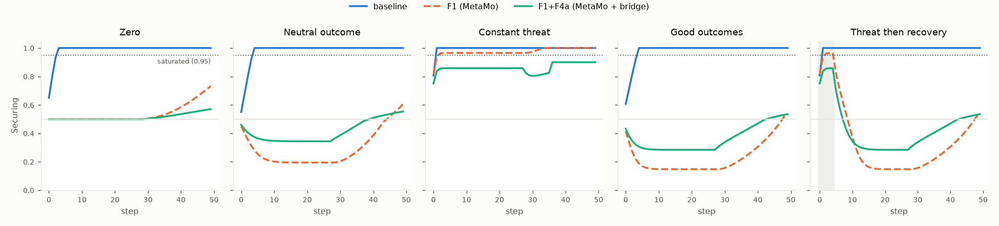

# Modulator saturation in the MetaMo ↔ SubRep loop

Research report. Everything here can be reproduced from this folder:

```
python experiments/modulator_saturation/run_hypotheses.py   # H1-H15
python experiments/modulator_saturation/run_fixes.py        # F1-F4 and combinations
python experiments/modulator_saturation/make_plots.py       # securing_before_after.png
```

The raw tables are in [results.md](results.md). Seed 7 throughout, though MetaMo
itself has no randomness. Steps are numbered from 0.

## 1. Summary

- **What happens.** Securing and Threshold reach 1.0 within 1–4 steps in every
  scenario, including an all-zero stimulus. They never come back down. Once they
  are pinned, the bridge emits ε = 0 and α = 0.05 (its floor) whatever the outcome.
- **The stimulus is not the cause.** MetaMo stepped on its own saturates in exactly
  the same way.
- **Root cause (MetaMo).** `project_to_safe_region` adds +0.1 to Securing and
  Threshold on every call, even when the state is already inside the safe region
  (`external/metamo/dynamics/stability.py:139-140`). It runs on every transition
  (`category/bimonad.py:56`).
- **Amplifier (MetaMo).** The same increment also makes the lax-distributive check
  fail on 99% of steps (348 of 350). Every failure runs the conservative fallback,
  and the fallback projects again (`bimonad.py:151`). That adds a second +0.1.
- **Why nothing pulls it back (bridge).** The bridge commits each full MetaMo step
  and never blends or resets. Its budgets read only Securing, Threshold and
  Approach.
- **Recommendation: F1 + F4a.** Together they pass all four acceptance checks on
  every scenario. Calm runs end at 0.53–0.57, Constant threat holds at 0.86–0.90,
  and Threat then recovery drops below 0.60 two steps after the threat ends.
  - **F1 (MetaMo):** raise caution in the projection only when it actually projects.
    This would be an opt-in flag that keeps the current default.
  - **F4a (bridge):** decay every modulator 20% toward neutral after each step. It
    works for any number of modulators.
  - **Open issue:** F1 lets the goals grow faster, which brings a slower drift from
    the safety boundary after about 28 steps. This is listed under limitations.

## 2. Background

SubRep drives MetaMo through `bridge/`. After each skill outcome,
`MetaMoGovernor.step` (`bridge/governor.py:225-248`) builds a stimulus (novelty,
conduciveness, risk, effort), calls `MetaMoPseudoBimonad.step` once and keeps the
result as its new state. `bridge/budget.py:144-190` turns Securing, Threshold and
Approach into the certification budgets: ε (a PDS tolerance) and α (a CVaR tail
level). These are the knobs that let caution loosen or tighten the safety
certificate (see the paper *SubRep-Minecraft-AIRIS_v2*).

One MetaMo step runs:

1. appraise (OpenPsi);
2. raise caution near the boundary;
3. decide (MAGUS);
4. damp the goal update;
5. project into the safe region.

Then three runtime checks run (lax-distributive, contractive, safe region). Each
failed check replaces the result with a conservative fallback: the average of the
old and new states, projected again.

In the 16-step demo, Securing went 0.50 → 0.85 → 1.00 by step 2 and stayed there.
So the budgets stopped responding to outcomes.

## 3. Starting hypotheses (as originally committed)

The full text, with thresholds, is in [HYPOTHESES.md](HYPOTHESES.md). It was
committed in `bb70439` before any experiment code. H1–H13 below are as committed.
H14 and H15 were added in `4596782`, after the first results and before their own
experiments.

| # | Family | Hypothesis (short) | Prediction "True if" (short) |
|---|---|---|---|
| H1 | stimulus | The stimulus is too strong at the demo's scales | Scales ×10: threat saturates ≥3 steps later, good outcomes never do |
| H2 | appraisal | The appraisal has no pull back to neutral | Zero stimulus from 0.85: still > 0.75 after 20 steps |
| H3 | appraisal | `ind_scale` amplifies caution | `ind_scale = 1` moves a first-saturated step by ≥ 2 |
| H4 | appraisal | The sigmoid squash pushes modulators to the bounds | Clip instead: removes or delays saturation by ≥ 3 somewhere |
| H5 | stability | The projection adds +0.1 on every call | Without it, calm scenarios never saturate in 50 steps and end at 0.50 ± 0.15 |
| H6 | stability | Boundary caution raises caution | Disabling it moves a first-saturated step by ≥ 2 |
| H7 | stability | Homeostatic damping is not involved | Disabling it changes Securing by ≤ 0.01 |
| H8 | runtime checks | The lax check fails routinely and triggers the fallback | Fails on ≥ 50% of steps, and forcing a pass moves saturation |
| H9 | runtime checks | The fallback re-adds caution | Average-only fallback cuts the per-step increase by ≥ 0.05 |
| H10 | runtime checks | The contractivity check is not involved | Passes on every step |
| H11 | loop | The bridge never decays or blends | Blending delays saturation ≥ 5 steps (Partial expected) |
| H12 | loop | The grid world avoids it through how it drives MetaMo | Its loop, without resets, stays < 0.95 for 20 steps, then drifts up |
| H13 | what the bridge reads | Three modulators make the budgets blind | After saturation, Valence/Approach move ≥ 0.10 while ε, α stay fixed |
| H14 | stability *(added)* | With F1-style removal, a slower drift comes from the boundary | Pressure > 0 before Securing > 0.60, and disabling boundary caution keeps calm runs at 0.50 ± 0.15 |
| H15 | stimulus *(added)* | At small scales, novelty holds Securing down | At demo scales with novelty 0, good outcomes saturate within 20 steps |

## 4. Method

- **Scenarios.** Five scenarios go through the bridge exactly as the demo uses it
  (`MetaMoGovernor`, scales 1.0 unless stated): Zero (all four stimulus values 0),
  Neutral outcome, Constant threat, Good outcomes, and Threat then recovery
  (5 threat steps, then good ones). Outcomes are fixed in `common.py`.
- **Run lengths.** Every configuration runs for 20 and for 50 steps.
- **MetaMo-only baseline.** The same scenarios step `MetaMoPseudoBimonad`
  directly, to separate MetaMo from the bridge.
- **Metrics.** Per step and final: Securing and Threshold; first step ≥ 0.95;
  number of steps ≥ 0.95; recovery (Securing < 0.60 within 15 steps of the last
  threat); emitted ε and α; and the pass/fail result of each runtime check.
  Checks are recorded with read-only wrappers around the original functions.
- **One change per experiment.** Each change is a monkeypatch, restored afterwards.
  No file under `bridge/` or `external/metamo/` was edited, and
  `git -C external/metamo status --porcelain` is empty.
- **Appraisal variants.** H3 and H4 use a copy of `OpenPsiAppraisal.appraise`. The
  copy was checked to reproduce the original on every step of every run (the
  script prints `True`).
- **Fixes.** Each fix was tested alone on every scenario at both lengths. The two
  combinations were tested only after that. Every fix is judged on four acceptance
  checks over the 50-step runs:
  - no saturation without threat;
  - Securing ≥ 0.80 within 3 steps of constant threat;
  - recovery within 15 steps;
  - calm scenarios end within 0.50 ± 0.15.
- **Grid-world comparison.** MetaMo's own loop (`usecase/`) was run with its own
  environment stimuli, and with each scenario's stimulus swapped in. Each run was
  done both with and without episode resets.

## 5. Findings

### 5.1 Verdicts

| # | Verdict | Measurement |
|---|---|---|
| H1 | **False** | At ×10 and ×100, Zero and Neutral still saturate at steps 3 and 4. Threat moves only 1 → 2. |
| H2 | **Partial** | Zero stimulus from 0.85: 0.627 after 20 steps (between the two thresholds). A neutral outcome pulls Securing well *below* neutral (0.196); a good one, to 0.148. |
| H3 | **False** | No first-saturated step moves. |
| H4 | **True** (by threshold) | Neutral 4 → 9, Good 4 → 18. But every scenario still saturates and Constant threat saturates earlier (1 → 0), so this is not a cause. |
| H5 | **Partial** | Zero, Neutral and Good never saturate in 50 steps. Neutral and Good end at 0.604 and 0.537, but Zero drifts to 0.732. |
| H6 | **False** | Boundary pressure is 0.000 on every baseline step, and nothing changes. |
| H7 | **True** | Largest Securing difference: 0.000000. |
| H8 | **True** | Fails on 348/350 steps (99%). Forcing a pass: Zero 3 → 6, Neutral 4 → 31, Good 4 → 33. |
| H9 | **True** | Mean per-step increase on failing steps: Neutral +0.113 → +0.007, Good +0.100 → +0.005, Constant threat +0.250 → +0.116. |
| H10 | **True** | 0 failures in all baseline runs. |
| H11 | **Partial** | Blending: never saturates in 20 steps (except Constant threat, at 19), but saturates by 50 (at 27–36). Resetting every 10 steps only hides it: Securing is ≥ 0.95 on 10–16 of the first 20 steps. |
| H12 | **True** | Grid-world loop without resets: first ≥ 0.95 at steps 20–41; by step 50 it is at 0.986–0.998. With resets it never saturates. |
| H13 | **True** | While saturated, Valence ranges over 0.636 and Approach over 0.669, but ε stays 0.0000 and α 0.0500. |
| H14 | **Partial** | Pressure first > 0 at step 28; Securing > 0.60 at step 42 (goal norm 1.90 → 1.94). Disabling boundary caution keeps Zero at 0.500, but Neutral and Good settle at 0.194 and 0.148, outside 0.50 ± 0.15. |
| H15 | **True** | At demo scales, Good outcomes go from never saturating to first saturating at step 3 once novelty is 0. |

### 5.2 Confirmed causes

1. **Unconditional caution in the projection** (H5). This is the primary cause.
   - `dynamics/stability.py:139-140` adds +0.1 to Securing and Threshold after any
     goal clipping, whether or not anything was clipped.
   - `_compute_transition` calls it on every step (`category/bimonad.py:56`). Even
     with a zero stimulus, Securing rises by about 0.1 per step until it hits 1.0.
   - The function's docstring (`stability.py:125-128`) describes only restoring
     the floor and shrinking the goals. It does not mention raising caution for a
     state that is already safe.
2. **The same increment makes the lax-distributive check fail** (H8).
   - The check compares two paths (`bimonad.py:178-186`). Path 1 applies the
     projection's +0.1 *after* the appraisal; path 2 applies it *before*.
   - The appraisal is nonlinear (the squash at `openpsi/appraisal.py:97`), so the
     two paths differ by much more than `LAX_DISTRIBUTIVE_DELTA = 1e-3`
     (`core/config.py:26`).
   - Evidence: with the increment removed (H5), the check passed on every step of
     every 20-step run.
3. **The fallback adds the increment again** (H9).
   - Each failed check calls `_apply_conservative_fallback`
     (`bimonad.py:143-151`). It averages the two states, which is meant to
     *shrink* the step, then calls `project_to_safe_region` again (line 151).
     That adds another +0.1.
   - So most steps add caution twice.
4. **The bridge has no way back** (H11, H13).
   - `bridge/governor.py:244-247` stores the full step output. There is no
     blending and no decay, and the state is never reset.
   - The budgets read only Securing, Threshold and Approach
     (`bridge/budget.py:144-190`). Once the first two are pinned, ε and α stop
     moving, even while Valence and Approach respond to good outcomes.
5. **Secondary: goal growth toward the safety boundary** (H14). This shows up
   only once cause 1 is removed.
   - The bridge's candidate archetypes have only positive goal nudges
     (`delta_g = 0.02 × value`, `bridge/governor.py:277`, candidates at
     `289-291`). The goals clipped to [0, 1] keep growing, until the goal norm
     approaches `G_MAX = 2.0`.
   - Inside the boundary band, `raise_boundary_caution`
     (`dynamics/stability.py:66-79`) adds caution, and the contractivity check
     becomes active.
   - In the baseline, the fallback halves every goal step, which is why boundary
     pressure stayed 0 there (H6).
6. **Not causes:**
   - the stimulus strength (H1), `ind_scale` (H3), damping (H7) and the
     contractivity check (H10);
   - the squash (H4), which changes timing only.
   - The appraisal does pull back toward neutral, but weakly (H2). For neutral and
     good outcomes it pulls *below* neutral. That matters for how a fix behaves
     (section 6).

### 5.3 Comparison with MetaMo's grid-world example

The grid world (`usecase/metamo/core.py:213-251`) drives MetaMo differently:

- It calls `consensus_transition`, which runs **no runtime checks**, so there is no
  fallback and no second increment.
- It projects once (`core.py:231`, `249`).
- It moves only part of the way to the target, with `blend_states` (`core.py:232`,
  `250`; blend factor about 0.1–0.15).
- It resets the motivational state every episode
  (`usecase/agents/metamo_agent.py:63-67`).

It still contains cause 1. Run without resets, it saturates too, just more slowly:

| Stimuli | Resets | First step ≥ 0.95 | Securing at step 50 |
|---|---|---|---|
| Own environment | none | 41 | 0.986 |
| Own environment | every 10 steps | never | 0.552 |
| Scenarios (Zero … Threat then recovery) | none | 20–38 | 0.991–0.998 |
| Scenarios | every 10 steps | never | 0.618–0.814 |

So the grid world does not avoid the problem. Its short episodes hide it. The
bridge shows it at once because it skips the blend, runs the checks (doubling the
increment) and never resets.

## 6. Proposed fixes



*Securing per step (50 steps). Shaded: the threat steps. Dotted: the 0.95
saturation line. The numbers are in results.md, under "Fixes".*

### 6.1 Results on every scenario (final Securing at 50 steps; first step ≥ 0.95)

| Scenario | Baseline | F1 | F2 | F3 | F4a | F4b | **F1+F4a** | F1+F4b |
|---|---|---|---|---|---|---|---|---|
| Zero | 1.000; 3 | 0.732; never | 0.966; 15 | 1.000; 4 | 0.900; never | 0.648; never | **0.570; never** | 0.521; never |
| Neutral outcome | 1.000; 4 | 0.604; never | 0.906; never | 1.000; 13 | 0.900; never | 0.625; never | **0.554; never** | 0.517; never |
| Constant threat | 1.000; 1 | 1.000; 2 | 1.000; 3 | 1.000; 1 | 0.900; never | 0.733; never | **0.900; never** | 0.750; never |
| Good outcomes | 1.000; 4 | 0.537; never | 0.791; never | 1.000; 33 | 0.873; never | 0.673; never | **0.535; never** | 0.509; never |
| Threat then recovery | 1.000; 1 | 0.537; 2 | 0.812; 3 | 1.000; 1 | 0.873; never | 0.607; never | **0.535; never** | 0.509; never |
| Recovers (steps after threat) | no | yes (4) | no | no | no | no | **yes (2)** | yes (1) |
| ε range, all runs | 0–0.114 | 0–0.334 | 0–0.176 | 0–0.176 | 0–0.111 | 0–0.135 | **0–0.258** | 0–0.173 |
| Acceptance checks passed (of 4) | 1 | 3 | 1 | 1 | 2 | 1 | **4** | 3 |
| Lax / contractivity failures | 249 / 0 | 93 / 29 | 246 / 0 | 136 / 0 | 249 / 0 | 220 / 20 | 96 / 47 | 102 / 55 |

The 20-step tables are in results.md. In those, F1+F4a never saturates in any
scenario.

### 6.2 Ranked

1. **F1 + F4a: recommended.** It passes all four checks.
   - Caution still rises under threat (0.75 → 0.86 within 2 steps, 0.90 by step
     50). It falls below 0.60 two steps after the threat ends.
   - ε moves again, over a range of 0–0.258.
   - *Side effects:*
     - Calm runs dip below neutral mid-run (Neutral 0.34, Good 0.28 at step 20),
       then drift back up to about 0.55 as the goals near the boundary (cause 5).
       The acceptance check is met at step 50, not at every step.
     - The 96 lax and 47 contractivity failures all happen after about step 28,
       inside the boundary band. They do not come from the fix itself; with no
       boundary pressure, F1+F4a has 0 failures in every 20-step run.
2. **F1 alone (MetaMo).** It removes saturation from calm runs and recovers in
   4 steps.
   - *Side effects:*
     - It over-swings: Neutral falls to 0.19 and Good to 0.15, with ε up to 0.33.
     - Constant threat still pins at 1.0 (that is the intended direction).
     - Zero drifts to 0.73 by step 50, because the goals now take full steps and
       reach the boundary band (H14). So the calm-range check fails.
   - It is the right upstream change, but needs something on the bridge side.
3. **F1 + F4b.** The calm runs are good (0.51–0.52), but 50% decay is too strong:
   Constant threat peaks at 0.75 and fails the "caution rises" check.
4. **F4a alone (bridge only).** It stops pinning at 1.0, but every scenario sits
   at 0.87–0.90, ε stays ≤ 0.11 and nothing recovers. It is not usable alone. Its
   equilibrium sits where the decay balances the +0.1 or +0.2 a step.
5. **F2 (MetaMo): the fallback keeps the averaged modulators.** It halves the
   increment. Neutral and Good no longer saturate, but Zero still does (at step 15)
   and nothing recovers.
6. **F3 (MetaMo): lax tolerance 1e-3 → 0.05.** It only delays saturation
   (Neutral 4 → 13). Saturation stays in every scenario. Not recommended: it
   loosens a check whose failures are a *symptom* of cause 1.

Also measured, and not proposed:

- blending in the bridge (H11a) only delays saturation;
- periodic resets (H11b) hide it.

### 6.3 What each change would look like

- **F1, MetaMo side (small, additive, keeps current behaviour):**
  - Give `project_to_safe_region` a keyword such as
    `raise_caution_when_inside: bool = True`. Apply the +0.1 at lines 139-140 only
    if the goals were actually clipped, or if the keyword is true.
  - Pass that through from `MetaMoPseudoBimonad.__init__` to the three call sites
    (`bimonad.py:56`, `69`, `151`).
  - With the default, every existing user, including the grid world, is
    unchanged. The bridge would opt in.
  - The experiments measured the opt-in behaviour, by monkeypatch. The flag
    plumbing itself is not tested here. That is for the MetaMo team to review.
- **F4a, bridge side (works for any number of modulators):**
  - After `bridge/governor.py:247`, store
    `M ← 0.5 + 0.8 · (M − 0.5)` for every modulator, whatever their number, using
    `MODULATOR_NEUTRAL`. Leave the goals unchanged.
  - *Side effects:*
    - The governor's state is no longer exactly MetaMo's output. The runtime checks
      then see the decayed state on the next step.
    - A single step's output is capped in effect near 0.9 under constant
      pressure.
    - The 0.20 rate was tuned on these five synthetic scenarios only.

## 7. Limitations and open questions

- **Synthetic outcomes and one setup.** The outcomes are synthetic, the bridge
  scales are 1.0, and the candidates are the bridge's three archetypes.
  - At the demo's calibrated scales, the baseline behaves differently for good
    outcomes (H15): their high novelty offsets the increment.
  - The fixes were not re-run at the demo's scales or inside the Minecraft demo.
- **Monkeypatched, not applied.** Fixes were tested by monkeypatch, not as file
  changes. The upstream flag in 6.3 is a proposal.
- **Goal growth (cause 5) is unresolved.** With F1, the goals reach the boundary
  band after about 28 steps, which brings in boundary caution and the contractivity
  fallback. Two open questions:
  - Should the bridge's archetypes include negative goal nudges?
  - Should MetaMo let goals relax?

  Neither was tested.
- **Below-neutral swing.** The appraisal pulls Securing below neutral for neutral
  outcomes (H2). Is low caution after *neutral* outcomes intended? It sets how far
  ε opens in quiet periods.
- **Questions for the MetaMo team:**
  - Was the +0.1 in `project_to_safe_region` meant to apply only when the state is
    actually projected?
  - Is `LAX_DISTRIBUTIVE_DELTA = 1e-3` meant to hold once that is fixed? With F1,
    the check passes on every step until the boundary band.
- **Metrics not covered.** The task's per-step metrics are recorded for Securing
  and Threshold. The other four modulators were traced only for H13.
